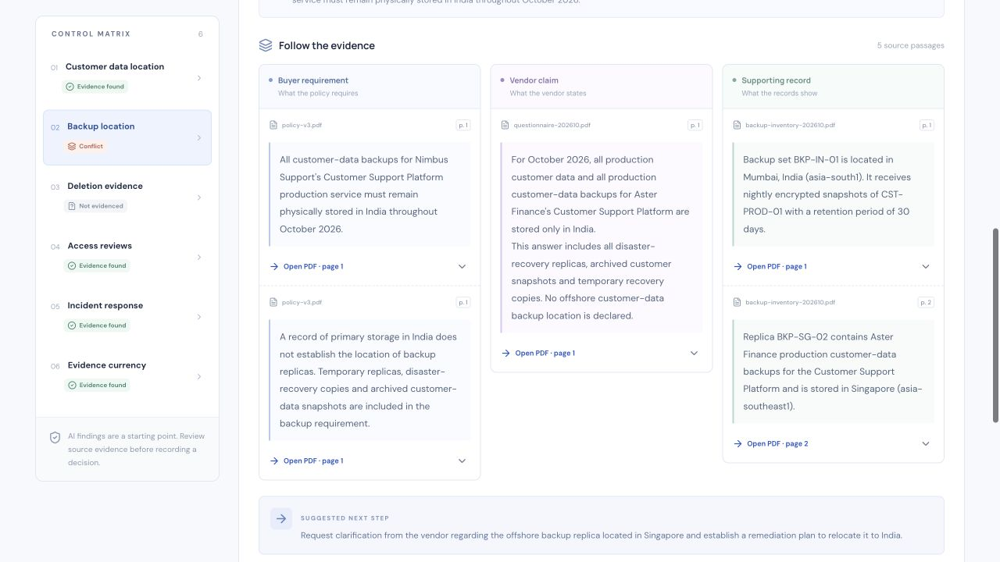
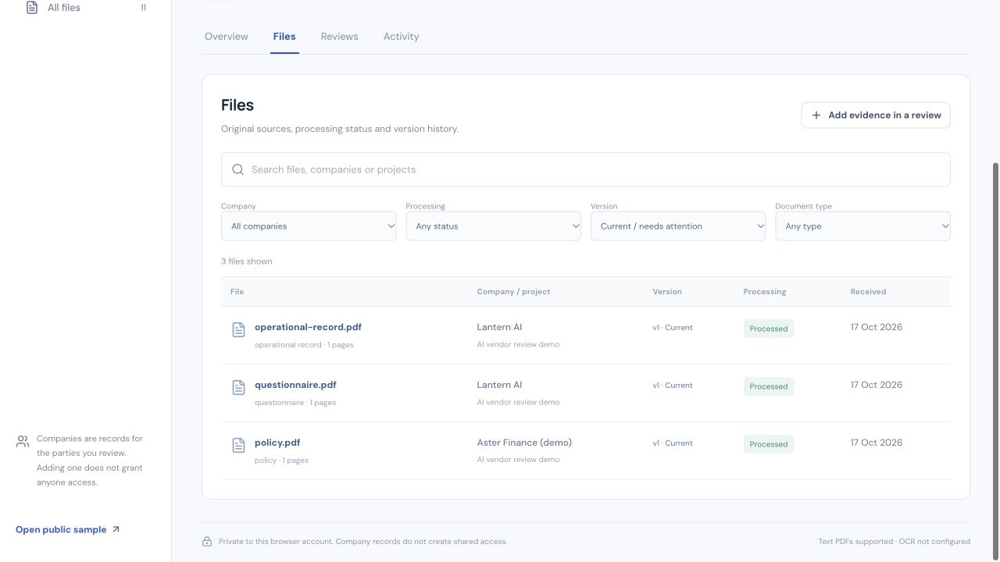

# EvidenceDesk

**Catch the gap between what a vendor promises and what its documents prove.**

EvidenceDesk is a vendor evidence review workspace for risk, procurement and operations teams. It compares a buyer's internal policy with vendor questionnaires and operational records, opens the supporting source passages, and preserves the analyst's decision in an exportable evidence pack.

The demonstration is entirely synthetic. Aster Finance requires its customer-data backups to remain in India. Nimbus Support's questionnaire claims they do. Its current production inventory records a backup replica in Singapore. The discrepancy involves the same vendor, service, environment and period. India-only storage is this fictional buyer's internal requirement, not a universal legal requirement.

[Open the live prototype](https://evidencedesk-web-hrndvaqjba-el.a.run.app) · [Watch the earlier 2:50 demonstration](https://drive.google.com/file/d/1G-S7X98fVB-zbEihmDhxyEEypMlNVUyt/view) · Synthetic evidence only



*Actual deployed application showing the synthetic evidence comparison.*

## What the workflow covers

1. Upload text-based PDFs into a scoped vendor review.
2. Extract document evidence and reconcile it against the selected pack’s six controls using Gemini.
3. Inspect exact quotations and source pages beside each finding.
4. Accept a finding, request clarification or mark it unresolved, with a note.
5. Export PDF or JSON containing review scope, coverage, findings and reviewer decisions.

The controls cover primary data location, backup location, completed deletion evidence, privileged access review, incident-response commitments and evidence currency. Processing failures remain visible and do not become evidence of absence. AI findings remain separate from subsequent reviewer actions.

## Project status

This repository contains implementation source, offline tests, a deterministic synthetic corpus, reviewed real model results and deployment scripts. The compact run matched all six expected outcomes; the 106-document run matched all six after a disclosed two-control retry. A fresh local HTTP test verified failure handling, session isolation and exports. See [evaluation status](evals/README.md) for measured usage, source-level checks and limitations.

The Cloud Run prototype is deployed. Its public sample and source PDFs are available. A deployed verification passed 115 resource, authentication, isolation, persistence and export checks. A separate four-PDF browser run executed the real cloud worker; its currency fallback was subsequently corrected to request human review when extraction omitted a date/version assessment. See [cloud authentication checks](evals/cloud-auth-verification.public.json), [the initial browser-run audit](evals/cloud-browser-verification.md) and [the verified correction](evals/cloud-currency-corrected-verification.json). The [published 170-second demonstration](https://drive.google.com/file/d/1G-S7X98fVB-zbEihmDhxyEEypMlNVUyt/view) is publicly viewable and was checked in a signed-out Incognito window. A separate final fresh four-PDF run passed 18 independent checks, including all 17 exact quotations, reviewer decisions, export and cloud persistence; see [the sanitized fresh-run receipt](evals/cloud-final-demo-verification.public.json). These checks concern this specific synthetic run, not general accuracy. Infrastructure scripts print plans until an operator configures and explicitly applies them.

## Workspace update

The updated hosted build passed its [workspace and version-history verification](evals/workspace-hosted-verification.json), plus 143 backend tests and four frontend helper tests.



Companies can participate in multiple projects, and each project can include a buyer, vendor, subprocessor, auditor or partner. Keep project details, review cycles, source files and reviewer decisions together. The file manager filters uploaded evidence by company, project, type, processing state and version.

Three versioned demo policy packs cover data handling, security assurance and AI vendor review. A demo creates real synthetic PDF files; findings are generated only when analysis runs. File replacements preserve original bytes, page-aware text comparisons and prior decisions pinned to exact document hashes. Reanalysis starts with unreviewed decisions.

Google Document AI OCR integration is optional and currently unconfigured on the hosted demo. It supports bounded scans/mixed PDFs when an operator supplies a regional processor and permissions; OCR provenance and verification warnings remain visible. The current workspace is private to its browser identity. Company records do not grant access or retrieve unshared files; vendor invitations, email ingestion and cross-company collaboration are future work. [Workflow and limits](docs/workspaces.md).

## Run locally

Use Python 3.12 and Node.js 22 or newer. The server uses a local SQLite store and filesystem blobs by default. AI calls are disabled until explicitly configured.

From the repository root:

```sh
python3 -m venv .venv
source .venv/bin/activate
python -m pip install -r app/requirements.lock
npm --prefix app/frontend ci
npm --prefix app/frontend run build
export EVIDENCEDESK_DATA_DIR="$PWD/.local/runtime"
export EVIDENCEDESK_ENABLE_AI=0
python -m uvicorn app.backend.main:app --host 127.0.0.1 --port 8080
```

Open [the local application](http://127.0.0.1:8080). A new installation has no precomputed sample. The sample endpoint deliberately reports that genuine analysis is unavailable until the compact pipeline run creates it. It does not substitute expected fixtures for model output.

For frontend development, run `npm --prefix app/frontend run dev` in a separate terminal. Vite proxies `/api` to the API on port 8080.

The durable local worker is a separate process. With the same environment and virtual environment, run:

```sh
python -m app.backend.worker
```

It claims persisted jobs and updates progress. Configure real AI before expecting submitted analysis jobs to complete.

## Configure real Google AI

The current implementation uses Google Gen AI SDK with a Vertex AI Gemini model and the `global` endpoint. Authentication uses Application Default Credentials locally and dedicated service identities in Cloud Run. Never put service-account keys or access tokens in source control.

1. Use your own billed Google Cloud project with Vertex AI enabled and appropriate model permissions. Check availability and pricing for the model in `app/backend/ai_client.py`.
2. Authenticate Application Default Credentials with Google Cloud CLI. CLI login and application credentials are distinct.
3. Set `GOOGLE_CLOUD_PROJECT` to your project and `GOOGLE_CLOUD_LOCATION=global`.
4. Create `.local/` if needed and copy `infra/local-budget.example.json` to `.local/budget.json`. Read the configured limits and prices in `ai_client.py`, then deliberately set the local ledger's `enabled` field to `true` only when you intend to incur charges. Never reset a used ledger to bypass its aggregate limits.
5. Set `EVIDENCEDESK_BUDGET_LEDGER` to that file and `EVIDENCEDESK_ENABLE_AI=1` for the evaluation or worker process.

```sh
export GOOGLE_CLOUD_PROJECT='your-gcp-project'
export GOOGLE_CLOUD_LOCATION=global
export EVIDENCEDESK_BUDGET_LEDGER="$PWD/.local/budget.json"
export EVIDENCEDESK_ENABLE_AI=1
python evals/run_compact.py
```

This command makes real, billable model calls, writes the actual compact result under `evals/`, and seeds the local sample only after processing completes. Completed processing does not by itself prove the findings are correct; compare the result with the frozen expectations and inspect the cited evidence.

The local ledger currently enforces aggregate limits of 100 calls, 1,000,000 input tokens, 100,000 output tokens and $10 estimated cost, with new dispatch stopped at a reserved total of $8. These are the limits in `ai_client.py`, not permission to consume a cloud budget. The cloud ledger uses separately reviewed, explicit limits in its own schema; no larger cloud limit is implied by this repository.

The model and prices reflect this prototype's validated configuration, not a promise of future availability or cost. The aggregate ledger reserves usage before dispatch and conservatively accounts for uncertain outcomes. Application limits and cloud billing alerts are not a universal spending guarantee.

## Tests and corpus

The current offline suite has 79 passing tests. Offline tests use synthetic inputs and mocked model responses. They do not require Google credentials or make model calls:

```sh
python -m pytest app/tests -q
```

The corpus includes:

| Pack | Documents | Pages | Purpose |
|---|---:|---:|---|
| Compact | 10 | 14 | Understandable six-control review and three-source contradiction |
| Scale | 106 | 110 | Varied current, historical, wrong-scope and irrelevant evidence |
| Separate adverse fixtures | 4 files | Mixed | Invalid PDF, no text layer, unsupported format and duplicate |

All 106 scale PDFs are included, together with source text and JSON. Regenerate them with `python data/generate_corpus.py`. See [corpus documentation](data/README.md), [scenario](docs/scenario.md) and [frozen evaluation expectations](evals/fixtures.expected.json).

The documents are deliberately short synthetic records. Their results cannot establish accuracy on arbitrary enterprise documents or real-world time savings.

## Architecture and deployment

The deployed architecture uses a Cloud Run web/API service and a private Cloud Run Job for durable analysis. Cloud Storage stores source PDFs and authoritative review artifacts, including decisions. A named Firestore database stores the review index, quotas and aggregate AI budget ledger. Firebase Authentication identifies writable sessions; the backend enforces workspace authorization. Gemini performs structured evidence extraction and per-control reconciliation.

Application storage and compute are configured for Mumbai (`asia-south1`), while Gemini uses `global`. This is not an India-only processing claim. See [architecture](docs/architecture.md) and the [deployment guide](infra/README.md).

Deployment scripts print plans by default and require `--apply` for mutations. Set your own project identifiers, inspect the exact resources and IAM grants, then follow the guide. The repository contains no deployment credentials or generated Firebase configuration.

## Limits

- Text-based PDFs only in the core workflow; image-only scans remain unresolved without OCR.
- The prototype compares evidence against a supplied internal policy. It does not certify legal compliance.
- A literal quotation can be valid yet interpreted incorrectly. Human review remains necessary.
- Archived, wrong-vendor and wrong-environment evidence must not satisfy current production requirements.
- Embedded document instructions are untrusted content, not authority to change the analysis or send messages.
- Public demonstrations use synthetic evidence. Do not upload real confidential documents to an unreviewed deployment.
- No claims of customer adoption, measured time savings, incident prevention or production readiness are made.

Organizer presentation assets and internal coordination records are intentionally excluded. No open-source license has been selected for this snapshot; do not assume permissions beyond applicable law until the project owner adds one.
