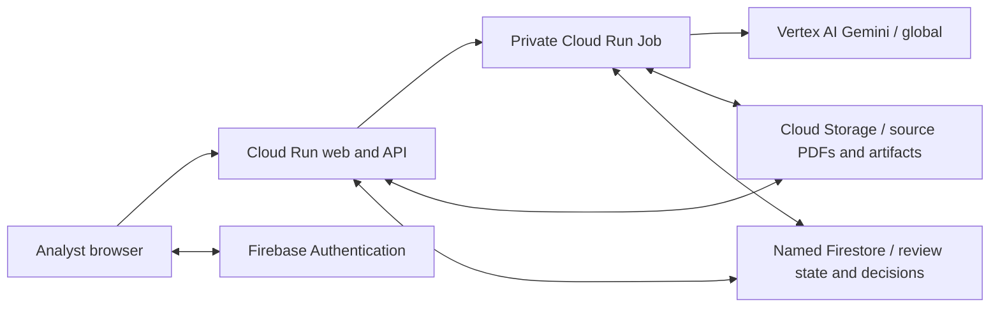

# EvidenceDesk architecture

The application separates a quick web request from durable analysis. The API stores a review and its source PDFs, then queues work. A separate worker extracts page text, asks Gemini for structured evidence and reconciles small evidence groups against the six controls in the selected versioned policy pack. Progress and artifacts persist so retries do not depend on the browser remaining open.

The default cloud deployment places application compute and storage in Mumbai. Gemini's global endpoint means this is not an end-to-end India-only processing design. The demonstration uses fictional evidence.

Locally, SQLite and filesystem blobs provide the same review workflow, with a separate worker process claiming persisted jobs. Cloud storage uses Cloud Storage and named Firestore. The API authorizes every private review; database access rules alone do not protect privileged server operations.

Each source retains document identity, hash, page text and extraction context. Literal quotations must exist on the cited page after whitespace normalization. Scope and date checks keep unrelated and obsolete material out of current findings. Valid quotations still need semantic review because a quotation can be real and the conclusion wrong.

AI findings and human decisions remain separate. New analysis preserves prior findings and decisions in history. The public sample is immutable; a user creates a private working copy to record a decision. Copying a follow-up draft does not send it to a vendor.

The application supports three versioned internal policy packs, each with six focused controls. It provides evidence review, not legal certification. Uploaded instructions are treated as untrusted evidence, and failed documents remain visible in coverage. A shared budget ledger reserves estimated usage before live AI dispatch and records settled usage conservatively.

Deployment scripts and this design are distinct from verification of a deployed release. Refer to the repository evaluation status and the operator's completed cloud checks before making availability or production-readiness claims.

## Company/project organization and versioned evidence

Owner-isolated workspace metadata stores companies, projects and participating parties in SQLite locally and a bounded Firestore document in cloud. Companies are organizational records, not access grants. Reviews keep project/company IDs and a pinned policy-pack version. The file manager uses authorized review indexes and sanitized document metadata; original PDFs remain in private blob storage.

Uploaded replacements are staged separately. The worker activates a replacement only after successful text extraction, preserving the prior file when parsing fails. Reconciliation consumes current versions only. Before activation the worker freezes the previous analysis source references; successful completion archives the prior findings and decisions with exact document hashes. Each new analysis starts with unreviewed decisions. Text comparison is page-aware and does not certify remediation.

Optional regional Document AI OCR is invoked only for valid bounded PDFs that lack text, with durable page reservations and an attempt marker to prevent automatic rebilling after uncertain failures. The hosted prototype leaves OCR disabled until a processor is configured. Original scans and extraction provenance remain available.

Generation-pinned GCS reads retry if a concurrent overwrite removes the pinned generation. A missing latest object establishes absence; a vanished older generation does not.
