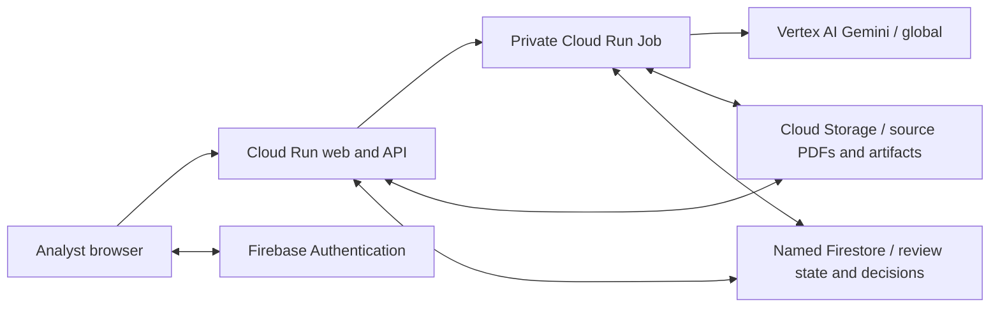

# EvidenceDesk architecture

The application separates a quick web request from durable analysis. The API stores a review and its source PDFs, then queues work. A separate worker extracts page text, asks Gemini for structured evidence and reconciles small evidence groups against six controls. Progress and artifacts persist so retries do not depend on the browser remaining open.

The default cloud deployment places application compute and storage in Mumbai. Gemini's global endpoint means this is not an end-to-end India-only processing design. The demonstration uses fictional evidence.

Locally, SQLite and filesystem blobs provide the same review workflow, with a separate worker process claiming persisted jobs. Cloud storage uses Cloud Storage and named Firestore. The API authorizes every private review; database access rules alone do not protect privileged server operations.

Each source retains document identity, hash, page text and extraction context. Literal quotations must exist on the cited page after whitespace normalization. Scope and date checks keep unrelated and obsolete material out of current findings. Valid quotations still need semantic review because a quotation can be real and the conclusion wrong.

AI findings and human decisions remain separate. New analysis preserves prior findings and decisions in history. The public sample is immutable; a user creates a private working copy to record a decision. Copying a follow-up draft does not send it to a vendor.

The application supports six internal controls rather than general document chat or legal certification. Uploaded instructions are treated as untrusted evidence, and failed documents remain visible in coverage. A shared budget ledger reserves estimated usage before live AI dispatch and records settled usage conservatively.

Deployment scripts and this design are distinct from verification of a deployed release. Refer to the repository evaluation status and the operator's completed cloud checks before making availability or production-readiness claims.
